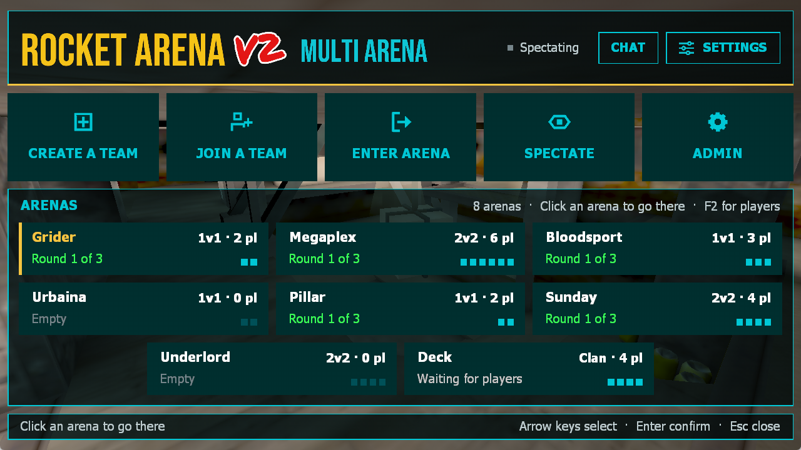
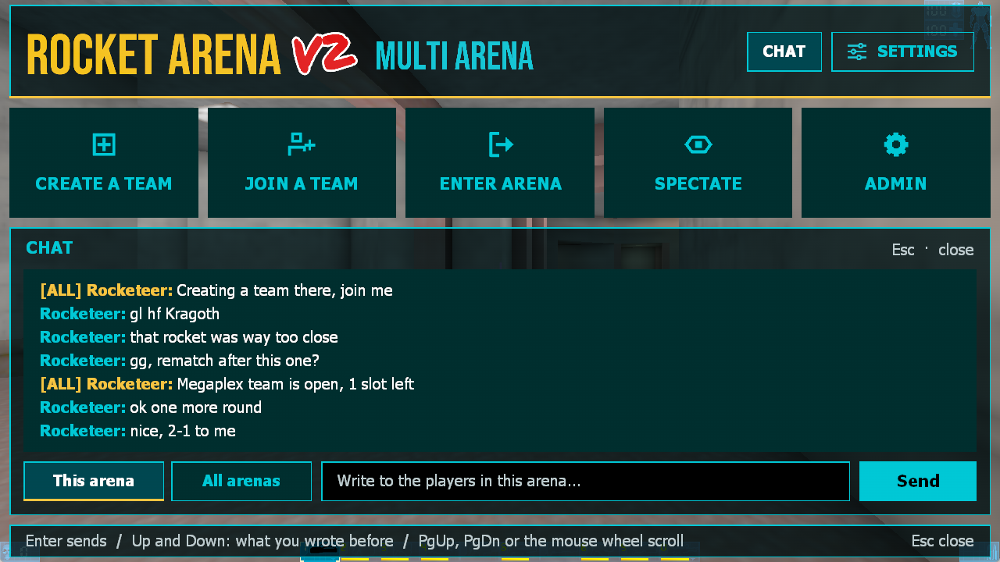
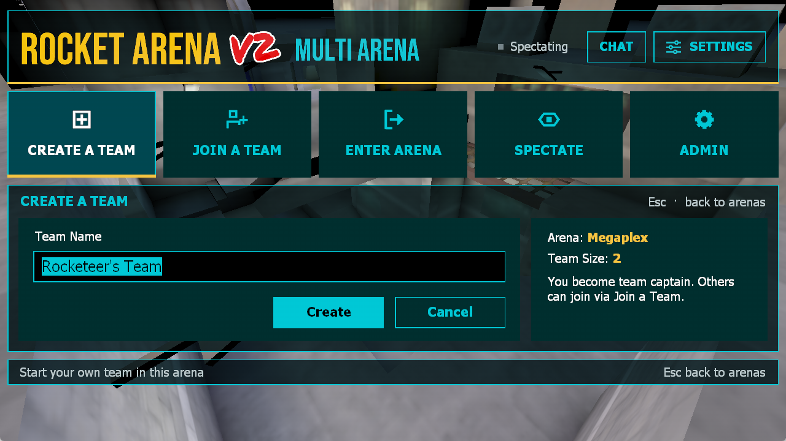
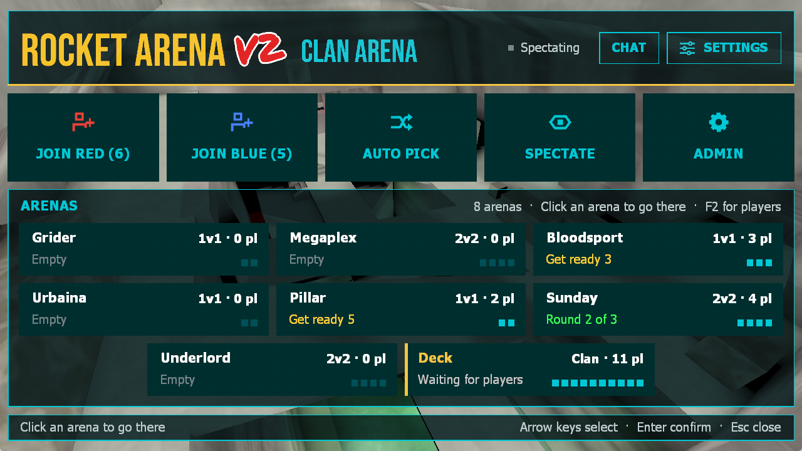
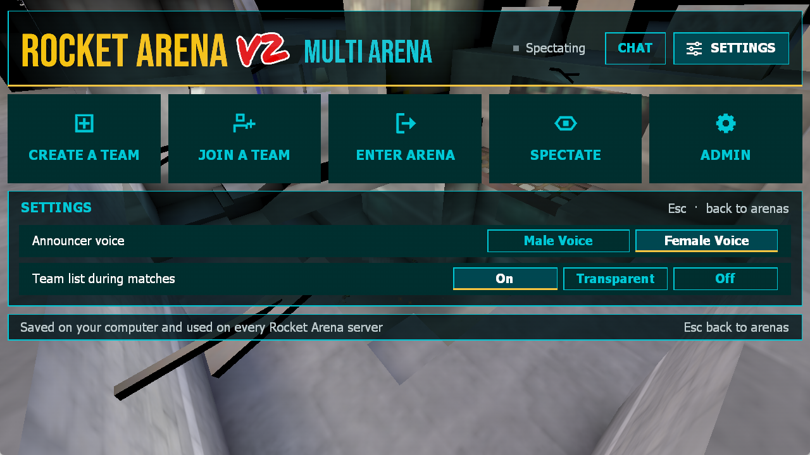
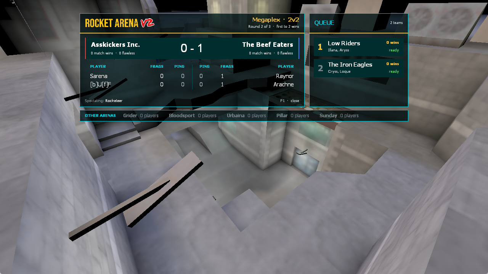
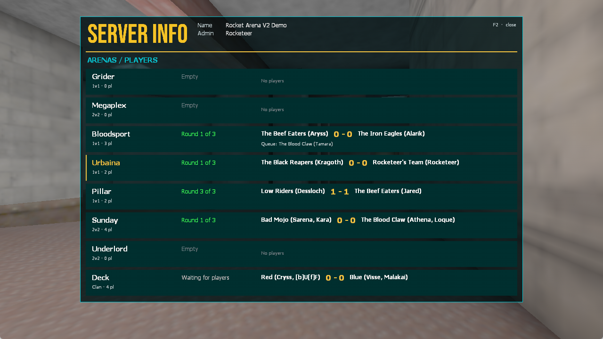
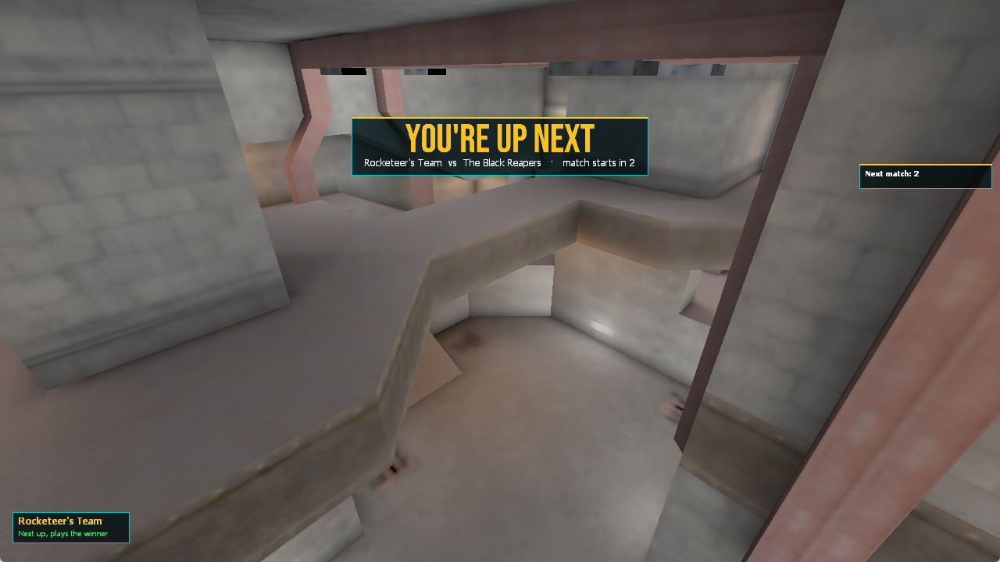
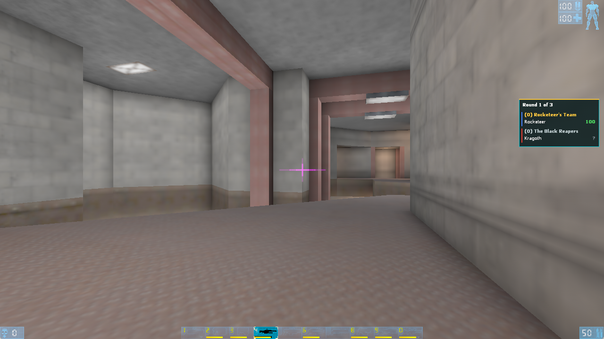
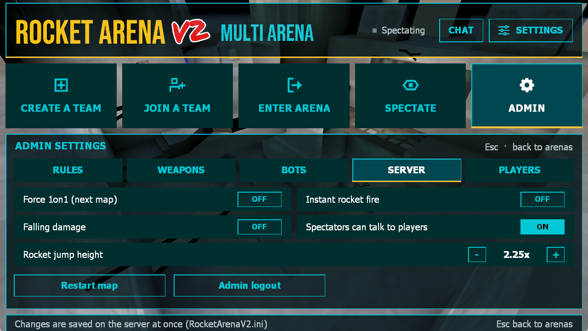

# Rocket Arena V2 for Unreal Tournament (UT99)

A rework of **Rocket Arena: UT 1.60** (2000) for UT99 **469**, built to run together
with **InstaGib+ (IG+)**. It also runs on plain servers without IG+.

The package is called `RocketArenaV2`, so it can sit on a server next to the original
`RocketArena.u`. It uses the original maps and the original `RocketArenaMedia.u` without changes.



---

## Why V2?

The original Rocket Arena does not work with InstaGib+:

- **Player class.** RA swaps every player to its own `RATMale1` class. IG+ forces its own
  player class (`bbPlayer`) and destroys any other. All RA player logic disappears with it:
  - no firing during the countdown
  - arena spectating
  - the `ra*` key commands
  - rocket-jump height
  - per-arena voices
- **Armor.** RA spawns armor at (0,0,0). IG+ replaces the armor class, but the replacement
  fails at that location, so players never get armor.
- **Ammo settings.** RA looks up weapons by exact class (`Enforcer`), but IG+ weapons are
  `ST_Enforcer` and so on. Any changed ammo setting caused `Accessed None` errors.

V2 has **no player class of its own**. Players use whatever class the server's mutators
give them (IG+ or stock). All RA logic now lives in the game, the HUD and the mutators.
The package has no dependency on IG+ and works with any IG+ version.

---

## What's new compared with RA 1.60

### Gameplay
- **New round start.** Players spectate during the countdown and spawn at FIGHT with full
  ammo and armor, so nobody can shoot before FIGHT. This also works with IG+'s
  ping-compensated shots. A **GET READY** panel shows the round, the teams and the score.
- **No damage outside round time.** A rocket still in the air after the round is decided
  can't kill the winner.
- **Rocket jumps** (`BouncyHeight`) are done through a damage mutator.
- **Falling damage** can be turned on. In 1.60 it was always off because of an inverted check.
- **Ammo and armor settings** work with IG+ weapons (`IsA` instead of an exact class match).
- **Match wins are saved per arena** until you disconnect. If you leave an arena and come
  back, your new team keeps its win count.
- **Carcass collision** is on, so you can shoot bodies apart (`bEnableCarcassCollision` in the IG+ section).
- RA turns off `bTournament`. Otherwise IG+ treats the whole map as warmup and shows the green flag.

### Teams and queue
- **Create Team** queues the team right away. It plays once it is full.
- **Enter Arena** without a team gives you your own team at once. You can play alone, even 1 vs 2.
- **Join Team** queues you right away.
- A team in a running match is not split up before the match ends. In 1.60 this could shift
  the queue and reward or move the wrong team.
- **Spectating** in the middle of a match takes you out of your team. Before, you were put
  back in the next round.

### Menu (completely new)
- A dark, modern main menu. You can see every arena (1–8) at once as a card with its mode,
  status and players. Click an arena to go there. The NEXT ARENA button is gone.
- Join and Create are pages inside the menu. The old pop-up windows are gone.
- Separate layouts for **Clan Arena** (Join Red / Join Blue / Auto Pick / Spectate)
  and **Multi Arena**.
- **Settings**: announcer voice (built-in Male/Female, with a preview) and the team panel
  (On / Transparent / Off). These are saved on the client.
- **Chat window**. Open it with the CHAT button, with *RA: UT → Open Chat* in UT's menu bar,
  or with the `rachat` key.
  - Chat to *This arena* or *All arenas*.
  - The log covers the session (64 messages), with word wrap and scrolling.
  - Up/Down recalls what you wrote before. The limit is 150 characters.
- **Admin page** for logged-in admins:
  - **Rules**: best-of 1–9, self/team damage.
  - **Weapons**: per arena, with ammo and armor.
  - **Bots**.
  - **Server**: Force1on1, instant rockets, falling damage, spectator speech, rocket jump height, map restart.
  - **Players**: kick and ban.

  The server checks every value. Changes are saved to `RocketArenaV2.ini`.

### HUD and scoreboards
- **Team panel** on the right: round score, team names and HP. Opponents show "?" while you are alive.
- **Queue box** at the bottom left when you are not playing. It shows your team or spectator
  status, your place in the queue and how many players are in other arenas.
- **YOU'RE UP NEXT** with a sound when your team is next in line.
- **F1** is a new scoreboard for both arena types. It shows versus rows, mirrored player
  tables, a queue with match wins and an **OTHER ARENAS** row with the number of players in each arena.
- **F2** shows the whole server: one row per arena with its mode, status, teams, score, queue and spectators.
- All panels are hidden while the RA menu is open.

### Screenshots

| Chat | Create a team |
|---|---|
|  |  |

| Clan Arena | Settings |
|---|---|
|  |  |

| F1 scoreboard | F2 server info |
|---|---|
|  |  |

| You're up next | Team panel in a match |
|---|---|
|  |  |

| Admin |
|---|
|  |

The screenshots are from a local game with bots at 1280x720.

### Fixed bugs from 1.60
- **Exploit:** the server took a `PlayerPawn` from the client in `NextArena`, `PrevArena`,
  `CreateTeam` and `CreateAndQueueTeam`. A modified client could move another player out of
  the arena in the middle of a match. The server now always uses the calling player.
- **Perfect/Flawless** announcements never played (unreachable branch). Perfect is now
  based on the pawn's real health.
- **Queue:** `CleanUpTeams` could remove index -1 from the queue. That shifted the queue,
  and the team currently playing could disappear from it.
- End of game: `SetEndCams` hit `Accessed None` for every player, and everyone got arena 0's camera.
- **`RAMessageMutator`** looked up the second player of a message the wrong way, so messages were filtered by the wrong arena.
- Fixed several `Accessed None` errors:
  - `Logout`
  - `GiveWeapon`
  - `AddBot`, `SpawnBot`
  - `InitGame` on 469
- `AssessBotAttitude` was missing a `return`.
- Fixed a typo in the `.int` (`RocketArenaGam`).

### Removed
- `RATournamentPlayer` and the whole player class hierarchy.
- Multimesh and Bonus Pack model support (`RocketArenaMultiMesh`).
- The old configuration and admin window in UT's menu bar. *RA: UT* now opens the V2 menu and the chat.
- Round Robin, which was never finished or selectable in 1.60, and other unused 1.60 code.

---

## Key bindings

These can be bound under *Options → Controls* (RA section) or in `User.ini`:

| Command | Action |
|---|---|
| `ramainmenu` | Open the RA menu |
| `ranextarena` / `raprevarena` | Next / previous arena |
| `raenterarena` | Enter the arena |
| `GlobalTalk` | Talk to all arenas |
| `rachat` | Open the chat window |

---

## Server installation

Download from [Releases](../../releases):

- **`RocketArenaV2-x.y.zip`**: everything for `UnrealTournament/System/`, plus `INSTALL.txt`.
- **`RocketArena-Maps.zip`**: the 22 RA maps for `UnrealTournament/Maps/`. You only need it if the server doesn't already have them.

The same files are also in [`System/`](System) on the `main` branch.

| File | |
|---|---|
| `RocketArenaV2.u` | game code |
| `RocketArenaV2Media.u` | V2 graphics (logo, icons) |
| `RocketArenaV2.int` | texts and game type registration |
| `RocketArenaV2.ini` | settings per arena (weapons, ammo, best-of, damage) |
| `RocketArena.u`, `RocketArenaMedia.u` | the original RA:UT 1.60 files, unchanged |

**Why the original files are needed:** the RA maps contain actors of the original classes
(`RocketArena.ArenaInfo`, `ArenaPlayerStart`, `ArenaViewCam`), so a map can't load without
`RocketArena.u`. V2 also uses the original announcer voices from `RocketArenaMedia.u`.
V2 works with both the original 1.60 `RocketArena.u` and the commonly used patched version.
If a server already has one of them, keep it.

**ServerPackages**, in this order:
```ini
ServerPackages=RocketArenaMedia
ServerPackages=RocketArenaV2Media
ServerPackages=RocketArenaV2
```

**Start the server with IG+** (replace `InstaGibPlus_xxx` with your IG+ package):
```
UCC server RA-Akuma?game=RocketArenaV2.RocketArenaGame?Mutator=InstaGibPlus_xxx.UTPure,InstaGibPlus_xxx.ST_Mutator?IGPlusSettings=ServerSettingsRA?IGPlusWeaponSettings=WeaponSettingsRA
```

In `InstaGibPlus.ini`, copy the sections you already use (for example your TDM sections) to
`[ServerSettingsRA]` and `[WeaponSettingsRA]`, and set these in `[ServerSettingsRA]`:
```
bWarmup=False
bAutoPause=False
```
RA starts rounds by itself, and an auto pause would pause every arena on the server.

Without IG+, leave out the mutators: `?game=RocketArenaV2.RocketArenaGame`.

---

## Building from source

The source code is on the [`source`](../../tree/source) branch. The `main` branch only holds
the files needed to install.

You need:
- Windows with UT99 **469f** installed (for `UCC.exe` and the engine packages).
- Git Bash (or another bash).
- To rebuild the graphics: Python 3 and the fonts in `deps/fonts` (Bebas Neue: OFL, Permanent Marker: Apache 2.0) installed.

```bash
UT_DIR=/d/UnrealTournament_469f_RC5 ./build.sh --setup   # first time: copies the engine into ./build
./build.sh                                               # build -> dist/RocketArenaV2.u
./build.sh --media                                       # also rebuild RocketArenaV2Media (only when the art changes)
```

The UT installation is never modified. The build runs in a private copy under `./build`.

**Important:**
- `src/RocketArenaStub` is a *build-only* stub of three classes from the original package
  (`ArenaInfo`, `ArenaPlayerStart`, `ArenaViewCam`), which the maps reference by name.
  **Never ship the stub's `RocketArena.u`.**
- A rebuilt media package gets a new GUID. Clients that already have the old one get a version
  mismatch, so rename the package if the art changes after a release.

### Release zips
```bash
python -I tools/make_release.py 1.0 [maps dir]   # -> release/RocketArenaV2-1.0.zip + RocketArena-Maps.zip
```
The original 1.60 files are taken from `RocketArenaUTFull160.umod` in the project root.
That file is not in git; get it from the original RA:UT 1.60 release.

---

## Project structure

On the `source` branch:

```
src/RocketArenaV2/Classes   game code (UnrealScript)
src/RocketArenaV2.int       localization / game type registration
src/RocketArenaV2Media      V2 graphics (textures + import class)
src/RocketArenaStub         build stub for the original map classes (do not ship)
deps/                       original RocketArenaMedia.u, fonts, original bitmaps
dist/                       built files to put on a server
tools/                      media generation (make_media.py), package imports, release zips
docs/screenshots/           images for this README
```

---

## Credits

- **Rocket Arena: UT** (2000) by David "CRT" Wright, Brandon "GreenMarine" Reinhart,
  Mike "Mongo" Lambert and the Rocket Arena team. All game ideas, maps and original
  graphics are theirs.
- **InstaGib+** by Deaod and contributors ([rxut/InstaGibPlus](https://github.com/rxut/InstaGibPlus)).
- RA V2 is made by devereux @ PlayUnreal.
- Fonts: Bebas Neue (SIL Open Font License) and Permanent Marker (Apache License 2.0).

## License

The V2 code is released under the [MIT License](LICENSE). The original Rocket Arena: UT
files, maps and graphics belong to the Rocket Arena team, and the fonts keep their own
licenses (see [LICENSE](LICENSE)).
